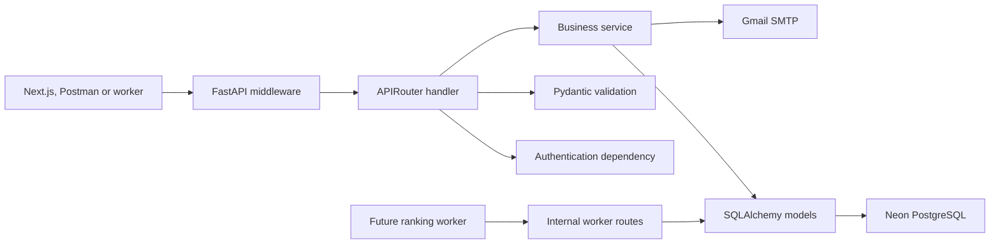
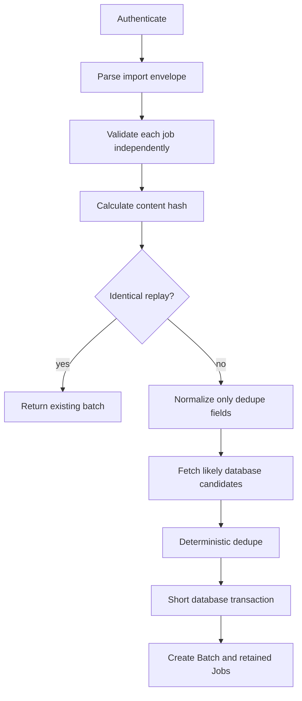
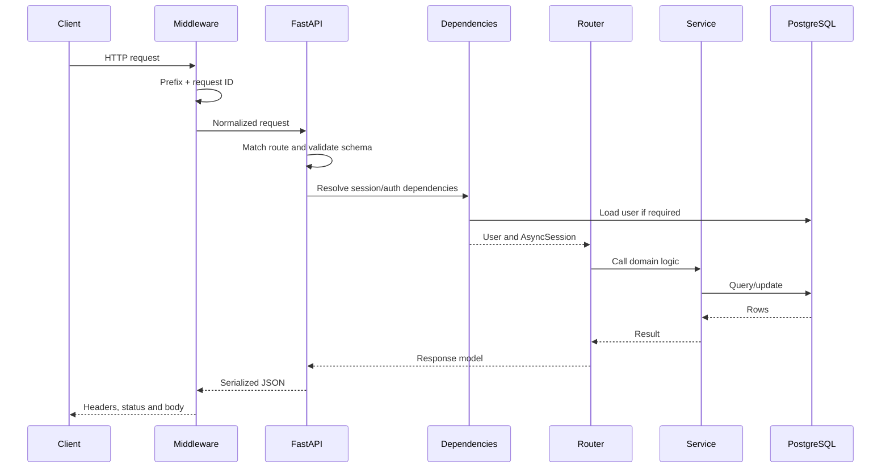

# JEDI Backend Architecture Guide

This document explains the backend as if you are new to FastAPI. It focuses on
what each directory owns, how files call one another, and how a request moves
through the system.

## 1. The simplest mental model

The backend has five main layers:

```text
HTTP request
  -> middleware
  -> router
  -> schema and dependencies
  -> service/database
  -> HTTP response
```

- **Middleware** runs around every request.
- **Routers** define URLs and coordinate work.
- **Schemas** validate incoming and outgoing data.
- **Services** contain reusable business logic.
- **Database models** represent PostgreSQL rows.

FastAPI uses Python type hints to understand what a route needs. For example:

```python
async def get_job(job_id: str, user: CurrentUser, session: DatabaseSession):
```

FastAPI reads `job_id` from the URL, resolves `CurrentUser` through an
authentication dependency, creates `DatabaseSession` through another
dependency, and only then calls `get_job`.

## 2. High-level system map



External systems:

- **Next.js** will call the user-facing `/api/*` routes.
- **Neon PostgreSQL** stores users, jobs, batches, labels and processing state.
- **Prisma** owns schema definitions and migrations.
- **SQLAlchemy** is how Python reads and writes those Prisma-created tables.
- **Gmail SMTP** sends top-ten digests when email is enabled.
- **Vercel Services** exposes FastAPI below `/svc/ml`.
- A future **model worker** will claim queued ranking runs.

## 3. Backend root files

### `backend/main.py`

This is the application entry point. Uvicorn imports `backend.main:app`.

Key responsibilities:

- Creates the `FastAPI` object.
- Registers CORS, request-context and service-prefix middleware.
- Installs global exception handlers.
- Includes every router.
- Disposes database connections during shutdown.

Important code:

- `lifespan()` runs startup/shutdown lifecycle logic.
- `app = FastAPI(...)` creates the application.
- `app.add_middleware(...)` adds behavior around every request.
- `app.include_router(...)` connects route modules to the application.

Router registration is essential. A function decorated with `@router.get` does
not become reachable until its router is included by `main.py`.

### `backend/config.py`

This converts environment variables into a typed `Settings` object.

Key components:

- `Settings` declares every supported environment variable.
- `model_config` tells Pydantic Settings to read `.env`.
- `validate_production_safety()` rejects unsafe production configuration.
- `allowed_origins` converts comma-separated CORS origins into a list.
- `sqlalchemy_database_url` changes `postgresql://` into SQLAlchemy's
  `postgresql+psycopg://` form.
- `get_settings()` is cached so settings are not reparsed on every request.

Production checks reject placeholder URLs, short secrets, insecure cookies,
non-HTTPS origins, and incomplete email configuration.

### `backend/database.py`

This is the Python view of the PostgreSQL schema.

It contains:

- SQLAlchemy engine and session factory.
- Enum mappings.
- ORM classes for every database table.
- `get_session()`, the FastAPI database-session dependency.
- `new_id()` and `utc_now()` convenience functions.

Important distinction:

- A **Pydantic schema** describes HTTP JSON.
- A **SQLAlchemy model** describes a database row.

`get_session()` yields one `AsyncSession` per request. `async with` and `yield`
ensure the session closes even when the route fails.

Current ORM models:

| Model | Meaning |
| --- | --- |
| `User` | Private login email and password hash |
| `Batch` | One pasted/imported group of jobs |
| `Job` | One retained, deduplicated job |
| `ProfileVersion` | Immutable resume and preferences |
| `PreparedJob` | Model-ready features for one job/profile/schema |
| `GroupMember` | Privacy boundary for one user's activity inside the shared group |
| `JobState` | Per-member viewed timestamp, relevance and review state |
| `Application` | Per-member application plan and current funnel stage |
| `ApplicationEvent` | Append-only history attached to one private application |
| `ApplicationMilestone` | Private company-specific rounds and follow-ups |
| `JobAnnotation` | Per-member binary label and nine manual fit scores |
| `TrainingExample` | Owner-approved canonical training row with annotator provenance |
| `ModelVersion` | Model artifact metadata and offline metrics |
| `JobPrediction` | Ranked result tied to one processing run |
| `ProcessingRun` | Normalization/ranking attempt and worker lease |
| `EmailDelivery` | Durable email state, snapshot and retry information |

### `backend/auth.py`

This contains reusable authentication logic, not URLs.

Key functions:

- `hash_password()` creates a one-way password hash.
- `verify_password()` checks plaintext against that hash.
- `create_session_token()` signs a JWT containing user ID, email and expiry.
- `decode_session_token()` verifies the signature and expiry.
- `get_current_user()` resolves Bearer/cookie authentication and loads `User`.
- `require_service_token()` protects internal worker routes.

Reusable dependency aliases:

- `CurrentUser` means “authenticate and provide a `User`”.
- `ServiceToken` means “verify `X-JEDI-SERVICE-TOKEN` before continuing”.

### `backend/middleware.py`

Middleware wraps requests before and after router execution.

`ServicePrefixMiddleware`:

- Detects `/svc/ml/...`.
- Removes the public prefix before FastAPI route matching.
- Preserves `root_path` so generated URLs understand the deployment prefix.

`RequestContextMiddleware`:

- Accepts or generates `X-Request-ID`.
- Measures request duration.
- Logs method, path, status and duration without bodies or secrets.
- Adds `X-Content-Type-Options: nosniff`.
- Adds `Cache-Control: no-store` to private routes.
- Converts unexpected exceptions into a generic safe `500` response.

### `backend/errors.py`

This makes API failures predictable.

Instead of returning unrelated error shapes, errors become:

```json
{
  "error": {
    "code": "NOT_FOUND",
    "message": "Job not found.",
    "requestId": "..."
  }
}
```

Key functions:

- `_status_code()` maps HTTP codes to stable application codes.
- `http_exception_handler()` handles deliberate `HTTPException`s.
- `validation_exception_handler()` handles invalid Pydantic input.
- `install_error_handlers()` registers handlers on the FastAPI application.

### `backend/__init__.py`

Marks `backend` as a Python package. It intentionally contains no startup logic.

### `backend/pyproject.toml`

Defines Python version, runtime dependencies, development dependencies, Ruff and
pytest settings. This file needs to remain at the backend package root.

### `backend/.python-version`

Documents the intended Python runtime version for version managers and hosting.

## 4. `backend/commands/`

Commands are trusted terminal programs, not web routes.

### `commands/bootstrap_user.py`

Run through:

```powershell
npm run user:bootstrap
```

Flow:

```text
terminal prompt
  -> normalize email
  -> validate input
  -> find User by email
  -> hash password
  -> insert User or update passwordHash
  -> commit
```

`upsert_user()` contains the database logic. `main()` handles hidden terminal
input and disposes the database engine. There is no registration endpoint,
which keeps this private application smaller and safer.

### `commands/__init__.py`

Marks `commands` as an importable Python package so
`python -m backend.commands.bootstrap_user` works.

## 5. `backend/routers/`

Routers are the HTTP coordination layer. They should validate workflow state,
call reusable logic, commit transactions, and shape responses.

### `routers/health.py`

Owns metadata and health routes.

- `/` returns service metadata.
- `/health/live` proves the Python process is alive.
- `/health/ready` checks the database and migration state.
- `/v1/info` lists capabilities.

Known caveat: readiness currently checks the initial migration constant rather
than the latest reliability/email migration.

### `routers/auth.py`

Owns login, logout and session inspection.

- `login()` finds a user, verifies the password and sets an HTTP-only cookie.
- `logout()` deletes that cookie.
- `get_session_user()` demonstrates `CurrentUser` dependency injection.

### `routers/batches.py`

Owns ingestion, batch listing/detail and guarded deletion.

`create_batch()` performs:



Helper functions convert ORM objects into safe response models and calculate
action availability. Deletion is blocked after annotations, training rows or
rankings exist.

### `routers/workflow.py`

Owns the job-learning and ranking workflow.

- `normalize_batch()` builds `PreparedJob` rows for the active profile.
- `annotate_job()` updates one job.
- `annotate_batch()` updates multiple jobs atomically.
- `add_training_examples()` is owner-only, selects the owner's complete
  annotations and records who supplied the labels.
- `export_training_examples()` is owner-only and produces the shared model CSV.
- `queue_ranking()` locks the batch and creates a pinned queued run.
- `save_rankings()` is the authenticated manual result callback.
- `get_rankings()` returns the latest or one historical successful run.

### `routers/workspace.py`

Owns shared job discovery and private member review/application tracking.

- Profile version create/list/detail/activation.
- Paginated global job search.
- Job detail combines shared job/ranking evidence with only the current
  member's state, annotation, application, events and milestones.
- `POST /api/jobs/{jobId}/view` records an idempotent private viewed timestamp.
- Every state, annotation and application query is scoped by the authenticated
  user's `GroupMember.id`.
- Application list, planning, status events, summaries and milestones are
  private even when two members act on the same shared job.

Application status is changed only through events so a history always exists.
Database compound keys and unique constraints enforce one state, annotation and
application per member/job while allowing the same job to have independent rows
for every member.

### `routers/models.py`

Owns metadata-only model registration.

- Model content is hashed for idempotent replay.
- Artifact manifests and offline metrics are stored, not loaded.
- Activation deactivates other versions.

### `routers/operations.py`

Owns processing visibility and internal worker leasing.

- Lists safe processing history.
- Claims the oldest queued ranking run with `SKIP LOCKED`.
- Issues a five-minute lease token.
- Accepts heartbeat and failure updates.
- Persists internal ranking callbacks.
- Stops automatic retry after three lease attempts.

The worker receives versions pinned when the run was created. It never silently
switches to the newest profile/model.

### `routers/email.py`

Owns manual digest control, safe history and the cron endpoint.

- User cookie protects manual/history routes.
- `CRON_SECRET` Bearer authentication protects cron.
- Responses exclude recipients and message bodies.

### `routers/normalization.py`

Exposes the pure `PreparedJobV1` transformation directly at `/v1/normalize`.
The batch workflow uses the same transformation logic internally.

### `routers/embeddings.py` and `routers/scoring.py`

Define future contracts but intentionally return `501 not_implemented`.
They prevent fake model results while allowing the expected request shapes to be
designed and tested.

### Router `__init__.py`

Marks the router directory as a package. `main.py` imports router modules from
this package.

## 6. `backend/schemas/`

Schemas are Pydantic models for validation, serialization and OpenAPI.

### `schemas/product.py`

The main product contract file.

Important mechanisms:

- `ApiModel` converts snake_case Python fields to camelCase JSON.
- Field constraints enforce ranges and lengths.
- Validators reject reversed salary/experience ranges.
- Enums constrain labels and workflow statuses.
- Ranking validation requires unique jobs and contiguous ranks.
- Response models prevent sensitive database fields from leaking.

### `schemas/common.py`

Small service-level responses: metadata, health, information and explicit
not-implemented responses.

### `schemas/embeddings.py` and `schemas/scoring.py`

Future ML request/response contracts. The corresponding routers remain
placeholders.

### `schemas/normalization.py`

An older/general normalization contract. The active direct normalization route
currently uses the `NormalizeRequest` and `PreparedJobV1` definitions from
`schemas/product.py`.

### `schemas/__init__.py`

Marks the schema directory as a Python package. It contains no validation logic
of its own.

## 7. `backend/services/`

Services hold reusable domain logic that should not depend on one URL.

### `services/product.py`

Owns deterministic text cleanup, dedupe and feature preparation.

Key functions:

- `clean_text()` normalizes Unicode and whitespace.
- `company_key()` removes legal company suffixes.
- `canonical_url()` removes tracking parameters and fragments.
- `dice()` calculates token-set similarity.
- `ranges_overlap()` compares experience/salary ranges.
- `clean_job()` produces normalized storage/dedupe values.
- `is_duplicate()` applies company gating, exact URL/key checks and seven signals.
- `remove_duplicates()` compares database and same-upload candidates.
- `stable_hash()` creates reproducible content hashes.
- `prepare_job()` creates `PreparedJobV1` model features.

Duplicate policy:

1. Company must match.
2. Exact canonical URL or dedupe key means duplicate.
3. Otherwise seven signals are evaluated.
4. Five positive signals means duplicate.
5. Missing fields do not count as positive.

### `services/ranking.py`

Validates and persists ranking results.

- Confirms batch/profile/model/run ownership.
- Confirms model and run feature schemas match.
- Confirms every job belongs to the batch.
- Upserts predictions by job and processing run.
- Detects exact duplicate callbacks.

### `services/email.py`

Owns rendering, durable delivery state and SMTP.

Key mechanisms:

- Renders exact HTML/plain-text top-ten snapshots.
- Escapes job-controlled HTML values.
- Generates stable message IDs.
- Allows one automatic digest per batch/recipient.
- Claims due work using a lease.
- Retries after 15 minutes, 2 hours and 1 day.
- Stops after three attempts.
- Never rolls back valid rankings when SMTP fails.

### `services/__init__.py`

Marks the service directory as a Python package. Business logic lives in the
three service modules above.

## 8. `backend/tests/`

Tests provide different levels of confidence.

| File | What it proves |
| --- | --- |
| `test_health.py` | Service routes, readiness, headers, prefix and production settings |
| `test_cors.py` | Allowed and rejected browser origins |
| `test_product_api.py` | End-to-end API workflows using isolated SQLite |
| `test_postgres_integration.py` | PostgreSQL-specific enums, arrays, JSON and uniqueness |
| `test_postgres_concurrency.py` | Real row locks and competing worker/email claims |
| `test_server_essentials.py` | Generic errors and secret-safe logs |

SQLite tests are fast and isolated, but they cannot prove PostgreSQL locking.
That is why live PostgreSQL integration tests exist separately.

`tests/__init__.py` marks the tests directory as a package; it contains no test
cases itself.

## 9. Complete request lifecycle



## 10. Reliability mechanisms

- **Idempotency:** content hashes and idempotency keys make retries safe.
- **Transactions:** related writes commit together or roll back together.
- **Database constraints:** uniqueness provides final concurrency protection.
- **Row locks:** competing rank queues/workers cannot claim the same work.
- **Version pinning:** runs remember the profile/model/schema actually used.
- **Leases:** crashed workers can be reclaimed after timeout.
- **Append-only events:** application corrections preserve history.
- **Safe errors:** clients get request IDs without SQL, credentials or stack traces.
- **Durable email:** SMTP failure is retryable and cannot erase rankings.

## 11. Important current limitations

- Real `/v1/embed` and `/v1/score` implementations are deferred.
- The worker contract exists, but no deployed model worker is included.
- Live Gmail and Vercel preview smoke tests still require external configuration.
- Readiness should verify the latest migration.
- `POST /api/batches` works but its raw-body implementation is not represented as
  a request schema in generated OpenAPI.
- `backend.commands` should be added to the setuptools package list before a
  non-editable packaged installation is relied upon.

## 12. Trusted FastAPI references

- [Bigger Applications and APIRouter](https://fastapi.tiangolo.com/tutorial/bigger-applications/)
- [Dependency Injection](https://fastapi.tiangolo.com/tutorial/dependencies/)
- [Security Dependencies](https://fastapi.tiangolo.com/tutorial/security/)
- [Lifespan Events](https://fastapi.tiangolo.com/advanced/events/)
- [Response Models](https://fastapi.tiangolo.com/tutorial/response-model/)
- [Middleware](https://fastapi.tiangolo.com/tutorial/middleware/)
- [Handling Errors](https://fastapi.tiangolo.com/tutorial/handling-errors/)
